# Assignment 3: MLOps AI Agent

**Name:** Aimen Ahmad &nbsp;|&nbsp; **Roll number:** 22I-0922 &nbsp;|&nbsp; **Section:** A
**Course:** MLOps & Production AI Engineering, Fall 2026
**Repository:** https://github.com/aimennnnn/assignment-03-mlops-agent

Every number in this report comes from the running system. Screenshots are in
[`screenshots/`](screenshots) and raw tool output is in [`evidence/`](evidence).

## 1. What I built

An AI agent that answers plain-English questions about one ML project. It never guesses:
it calls tools on four real systems and answers from what they return. It can also do two
actions, but only after I type yes.

| System | What it does here |
|---|---|
| DVC | Keeps versions of the dataset |
| MLflow | Records every training run and model |
| Airflow | Runs the training pipeline |
| Kubernetes | Serves the prediction API |

The model is a breast-cancer classifier. The LLM is `openai/gpt-oss-120b` on Groq.

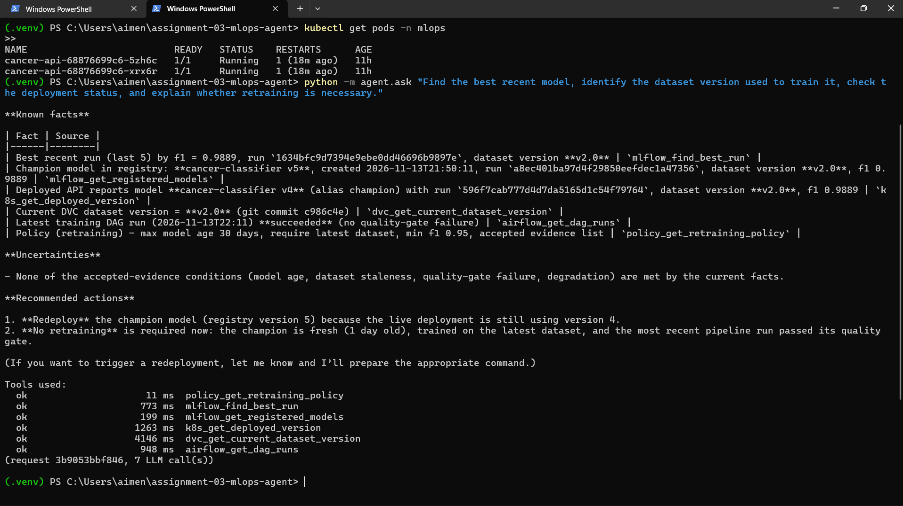

## 2. How it works

The LLM chooses what to look at. Plain code decides what is allowed.

1. I ask a question in plain English.
2. The LLM picks the tools it needs, out of 25.
3. Code checks every tool call first: valid inputs, allowed action, time limit.
4. The results go back to the LLM, which writes the answer.
5. Code adds what the LLM is not trusted to add: which tools failed, and anything still
   waiting for my yes.

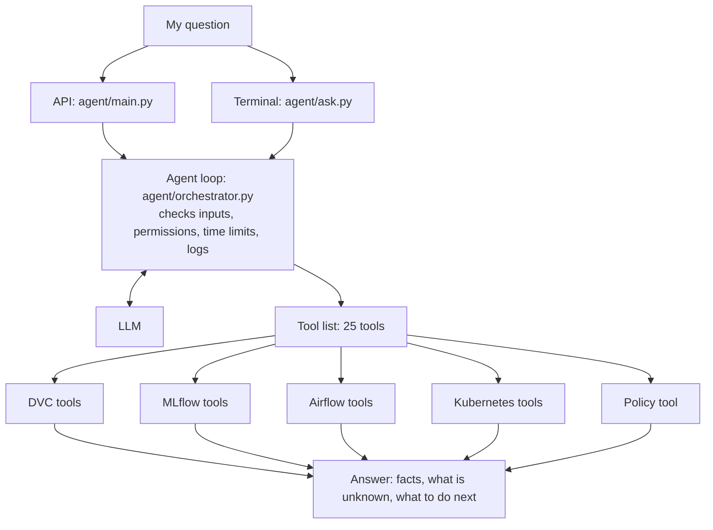

| System | Runs in | How the agent reaches it |
|---|---|---|
| DVC | The project folder | `dvc` and `git` commands, approved ones only |
| MLflow | My laptop, port 5000 | MLflow's Python client |
| Airflow | One Docker container, port 8080 | Airflow's REST API with a login token |
| Kubernetes | Docker Desktop, namespace `mlops` | The official Kubernetes Python client |

**How the four connect.** Every training run is tagged with its dataset version, and the
running app reports its model version. The same ids show up in every system:

```
DVC         data/cancer.csv -> hash 24d9881f... -> Git tag v2.0 (commit c986c4e)
MLflow      every run is tagged dataset_version=v2.0
Registry    model version -> run id -> alias "champion"
Kubernetes  the running app reports its model version at /version
```

More detail is in [architecture.md](architecture.md).

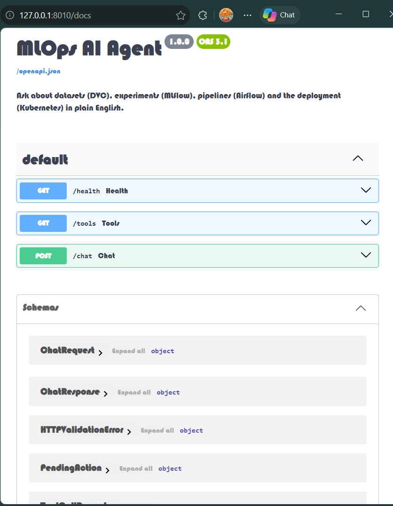

## 3. Tools and permissions

Every tool returns `"ok": true` or `"ok": false` and never crashes the agent. Inputs are
checked against the schemas in `agent/schemas.py` before a tool runs.

| System | Tools | Permission |
|---|---|---|
| DVC (5) | `dvc_list_tracked_datasets`, `dvc_get_current_dataset_version`, `dvc_compare_dataset_versions`, `dvc_check_data_changed`, `dvc_explain_reproduce_version` | Read only. Approved commands only. |
| MLflow (6) | `mlflow_list_experiments`, `mlflow_list_runs`, `mlflow_get_run_details`, `mlflow_find_best_run`, `mlflow_compare_experiments`, `mlflow_get_registered_models` | Read only |
| Airflow (5) | `airflow_list_dags`, `airflow_get_dag_runs`, `airflow_get_dag_run_status`, `airflow_get_failed_tasks`, `airflow_get_task_diagnostics` | Read only |
| Airflow (1) | `airflow_trigger_training_dag` | **Needs my yes.** Approved DAG only. |
| Kubernetes (6) | `k8s_list_workloads`, `k8s_get_pod_status`, `k8s_get_pod_logs`, `k8s_get_services`, `k8s_find_unhealthy_pods`, `k8s_get_deployed_version` | Read only. Namespace `mlops` only. |
| Kubernetes (1) | `k8s_restart_deployment` | **Needs my yes.** Namespace `mlops` only. |
| Policy (1) | `policy_get_retraining_policy` | Read only |

**Safety rules, enforced in code**

| Rule | Where |
|---|---|
| The 2 tools that change something never run without my yes | `execute_tool()` in `agent/orchestrator.py` |
| One yes allows exactly one change | `run_agent()` |
| Bad inputs are refused before the tool runs | `agent/schemas.py` |
| A failed tool is always listed in the answer | `_response()` |
| A retraining answer must check MLflow, the registry, DVC, Airflow and Kubernetes | `_missing_evidence()` |
| Bad data or a weak model can never be promoted | `validate()` and `gate()` in `training/pipeline.py` |
| Logs carry a request id and hide secrets | `agent/tracing.py` |

## 4. What the four systems show

### 4.1 DVC: dataset versions

There are two versions of the dataset. Checking out a tag brings back exactly that file,
and its hash proves it ([`evidence/dvc_tools.txt`](evidence/dvc_tools.txt)).

| | v1.0 | v2.0 (current) |
|---|---|---|
| Rows | 400 | 569 |
| Git commit | `64e5e07` | `c986c4e` |
| File hash starts with | `94bc26a8` | `24d9881f` |

```
git checkout v1.0 ; dvc checkout   ->  400 rows
git checkout main ; dvc checkout   ->  569 rows
```

A version that does not exist is refused, not guessed: asking for `v9.9` returns an error.

`dvc.yaml` holds one stage, `validate`. `dvc repro` runs the same dataset check that the
pipeline runs first.

### 4.2 MLflow: training runs

The best model is logistic regression on v2.0 with F1 0.9889. It is version 5 in the
registry and holds the `champion` alias.

There are 10 runs in 2 experiments. The first five were made by hand:

| Model | Settings | Dataset | F1 |
|---|---|---|---|
| Random forest | 10 trees | v1.0 | 0.9369 |
| Logistic regression | C 0.01 | v1.0 | 0.9661 |
| Random forest | 10 trees | v2.0 | 0.9457 |
| Random forest | 200 trees | v2.0 | 0.9670 |
| Logistic regression | C 1.0 | v2.0 | **0.9889** |

The best-run tool also warns when runs used different dataset versions, so the top score is
not trusted blindly ([`evidence/mlflow_tools.txt`](evidence/mlflow_tools.txt)).

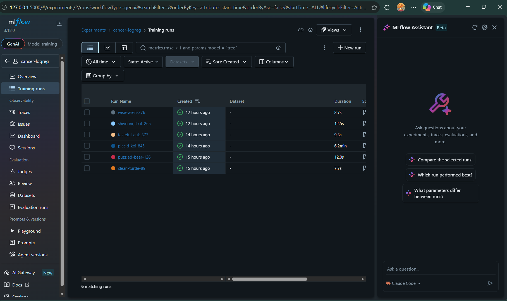

### 4.3 Airflow: the training pipeline

One DAG, `training_pipeline`, runs 5 tasks in a row. If one fails, the rest do not run.

```
validate_dataset -> preprocess_data -> train_model -> evaluate_and_log_to_mlflow -> apply_quality_gate
```

A failed task is retried twice, 20 s apart. Validation and the quality gate are never
retried, because bad data or a weak model does not fix itself.

| Run (13 Nov, UTC) | Result | Time | Failed at |
|---|---|---|---|
| 22:11:36 | Passed | 30.1 s | |
| 22:11:05 | Failed | 10.9 s | Validation |
| 21:49:23 | Passed | 48.2 s | |
| 19:56:30 | Failed | 31.2 s | Quality gate (weak model) |

Full output: [`evidence/airflow_tools.txt`](evidence/airflow_tools.txt).

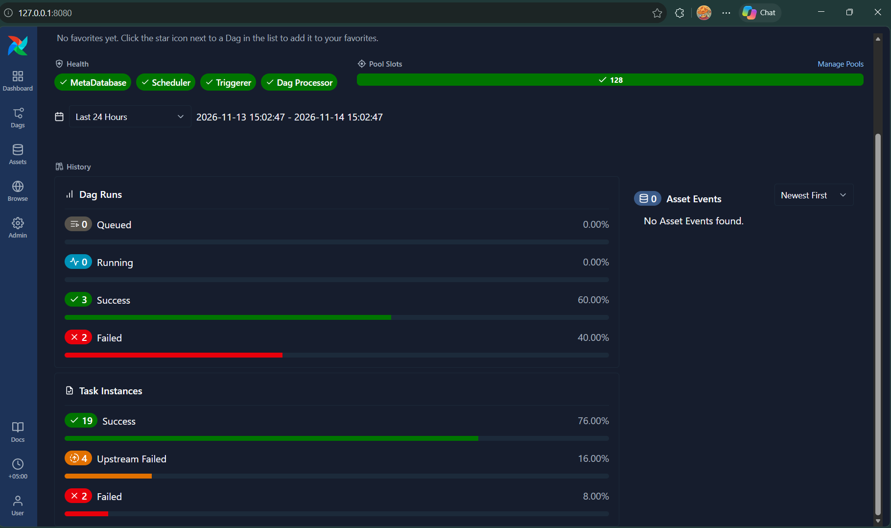

### 4.4 Kubernetes: the prediction API

Both pods are ready, and the app reports that it serves model version 4, trained on dataset
v2.0 ([`evidence/kubernetes_tools.txt`](evidence/kubernetes_tools.txt)).

| Requirement | How it is met |
|---|---|
| At least 2 replicas | 2 replicas, 2 of 2 ready |
| ClusterIP Service | Port 80 goes to the app's port 8000 |
| Health checks | Readiness on `/ready`, liveness on `/health` |
| CPU and memory | Asks for 100m and 256Mi, capped at 500m and 512Mi |
| ConfigMap | Holds the app version, model path and log level |

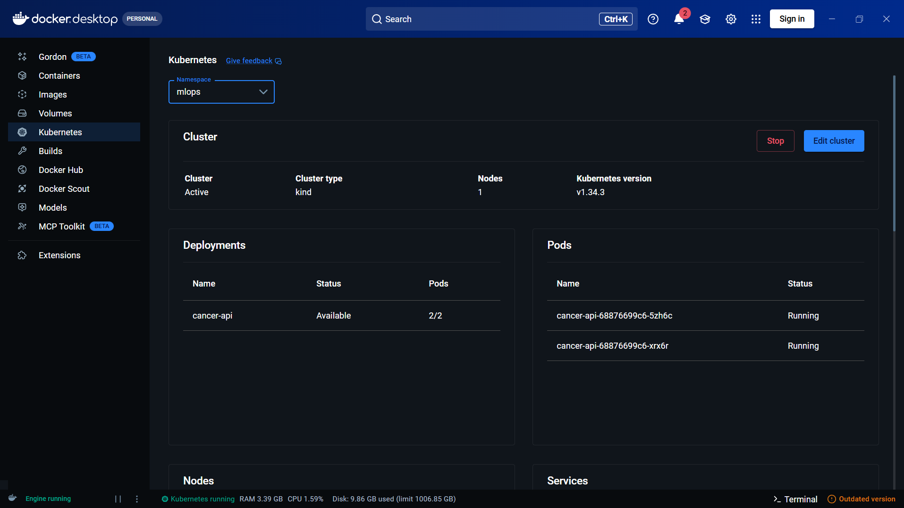

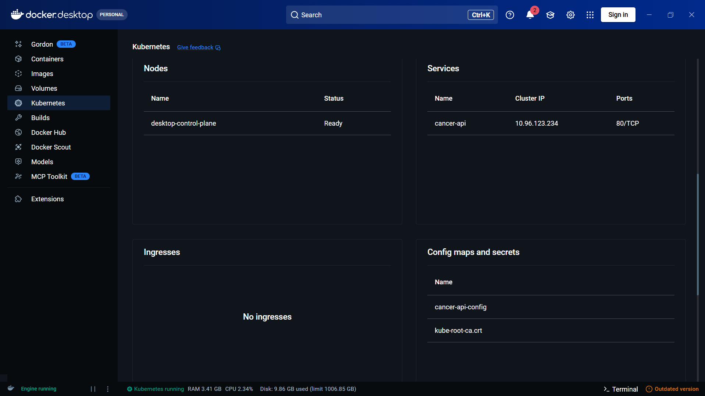

## 5. Five agent conversations

Each one shows my question, the tools the agent chose, and what it answered. Times come
from the agent's own log ([`evidence/agent_logs.txt`](evidence/agent_logs.txt)).

### Conversation 1: is retraining needed? (all four systems)

> Find the best recent model, identify the dataset version used to train it, check the
> deployment status, and explain whether retraining is necessary.

| Tool | Result | Time |
|---|---|---|
| `policy_get_retraining_policy` | ok | 4 ms |
| `mlflow_find_best_run` | ok | 933 ms |
| `mlflow_get_registered_models` | ok | 150 ms |
| `dvc_get_current_dataset_version` | ok | 2543 ms |
| `k8s_get_deployed_version` | ok | 999 ms |
| `airflow_get_dag_runs` | ok | 1076 ms |

**Answer.** Best model has F1 0.9889 on dataset v2.0. The champion is version 5, but
Kubernetes serves version 4. The latest pipeline run passed. So: no retraining, but
redeploy.

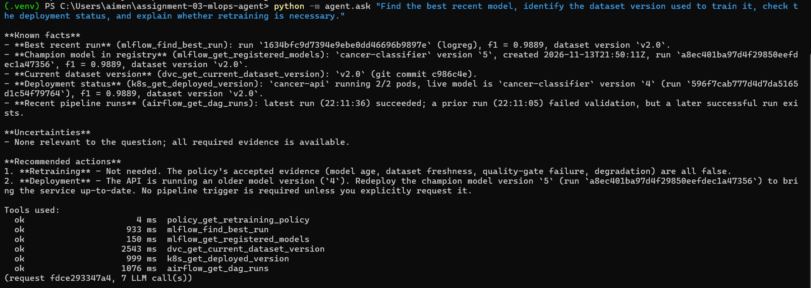

Asked earlier, right after a run failed the quality gate, the agent said retrain. Same
question, different evidence, different answer.

### Conversation 2: start the training pipeline (needs my yes)

> Trigger the model training pipeline and report whether execution succeeded.

The agent did not start anything at first. It showed what it wanted to do and waited.
After I typed `yes`:

| Tool | Result | Time |
|---|---|---|
| `airflow_trigger_training_dag` | ok | 793 ms |
| `airflow_get_dag_run_status` | ok | 53,633 ms (it waited for the run) |

**Answer.** The run finished with state `success` in about 53 s. All five tasks passed.

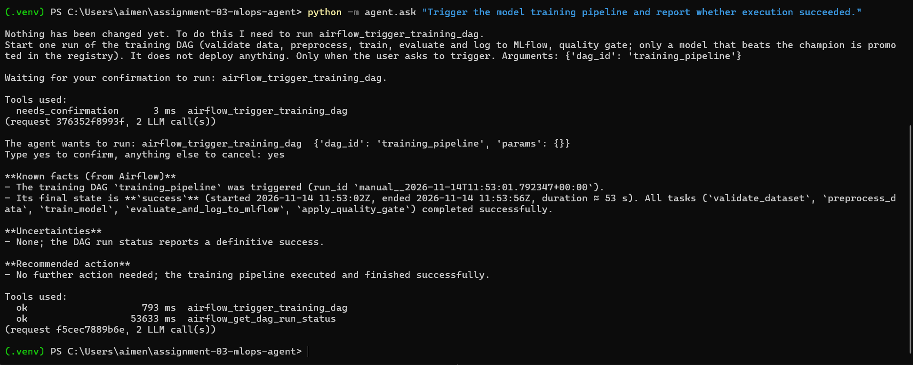

### Conversation 3: why did the pipeline fail?

> The latest training pipeline run failed. Find out which task failed and why, and tell me
> how to fix it.

| Tool | Result | Time |
|---|---|---|
| `airflow_get_dag_runs` | ok | 115 ms |
| `airflow_get_failed_tasks` | ok | 47 ms |
| `airflow_get_task_diagnostics` | ok | 181 ms |

**Answer.** The failed task is `validate_dataset`. Its log says `data/cancer.csv` was
changed without `dvc add`: the file's hash `99e2a9a3...` is not the DVC version
`24d9881f...`. See section 6.1.

### Conversation 4: why is my API down?

> Why is my prediction API unavailable?

| Tool | Result | Time |
|---|---|---|
| `k8s_list_workloads` | ok | 1199 ms |
| `k8s_get_pod_logs` | ok | 46 ms |
| `k8s_get_deployed_version` | ok | 12 ms |

**Answer.** 0 of 2 pods are ready and both are in `CrashLoopBackOff`. The pod log says the
model file `/app/model/missing-model.joblib` does not exist. The ConfigMap's `MODEL_PATH`
points to that file. See section 6.2.

### Conversation 5: a system is unreachable

> What is the best model by F1 score?

Asked while MLflow could not be reached.

| Tool | Result | Time |
|---|---|---|
| `mlflow_find_best_run` | error | 2057 ms |
| `mlflow_list_runs` | error | 2028 ms |
| `mlflow_get_registered_models` | error | 2082 ms |

**Answer.** The agent said it could not identify the best model, and the reply ended with
an "Unavailable evidence" note listing the three failed tools. It did not invent a number.

## 6. Failures I caused on purpose

### 6.1 Data changed without DVC

| | |
|---|---|
| **What I broke** | I added a line to `data/cancer.csv` without running `dvc add` |
| **What happened** | The pipeline stopped at its first task, `validate_dataset`, after 10.9 s |
| **How the agent found it** | It found the failed run, named the failed task, and read that task's log |
| **Root cause** | The file no longer matched the version recorded in DVC, so nobody could say which data the model would be trained on |
| **Why nothing bad happened** | Validation is the first task, so the four tasks after it never started. Nothing was trained or promoted |
| **Fix** | `dvc checkout --force` restored the file. The next run passed in 30.1 s |

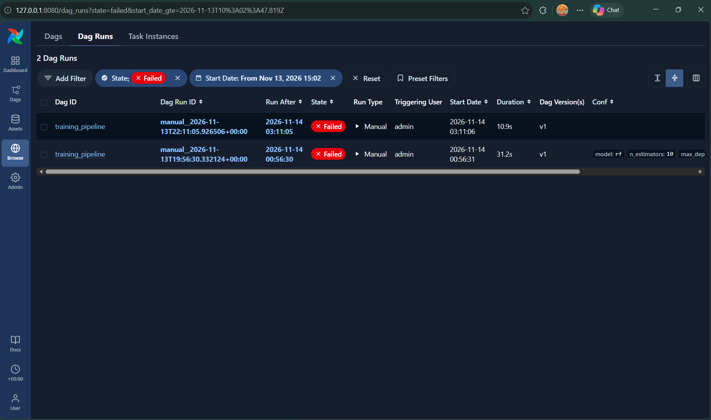

### 6.2 Wrong setting on Kubernetes

| | |
|---|---|
| **What I broke** | I pointed `MODEL_PATH` in the ConfigMap at a file that does not exist |
| **What happened** | Both pods went into `CrashLoopBackOff` and the API went down |
| **How the agent found it** | It listed the workloads, read the pod log, and checked the ConfigMap value |
| **Root cause** | A settings mistake, not a code or image problem: the app was told to load a model file that is not in the image |
| **Fix** | I applied the correct ConfigMap, then the agent restarted the deployment after I said yes. Both pods came back |

## 7. Testing and CI

All 52 tests pass on my laptop and on GitHub ([`evidence/tests.txt`](evidence/tests.txt)).
They use fakes, so they need no real cluster, server or API key. CI runs `ruff` and
`pytest` on every pull request and every push to `main`.

| What is proved | Test |
|---|---|
| The agent runs the tools the LLM picks | `test_agent_runs_the_tools_the_model_selects` |
| A slow tool times out cleanly | `test_tool_timeout_is_handled`, `test_airflow_timeout`, `test_dvc_timeout_is_reported` |
| Bad requests are rejected | `test_invalid_arguments_are_rejected_before_the_tool_runs`, `test_invalid_requests_are_rejected` |
| A service that is down returns an error, not data | `test_mlflow_down_returns_an_error_not_data`, `test_airflow_down_returns_an_error_not_data`, `test_no_cluster_configured` |
| The agent does not invent results | `test_agent_does_not_invent_results_when_a_tool_is_unavailable` |
| A Kubernetes change outside `mlops` is refused | `test_unauthorized_kubernetes_modification_is_rejected` |
| Secrets never reach the logs | `test_every_tool_call_is_logged_without_secrets`, `test_secret_values_are_redacted` |
| The quality gate blocks a weak model | `test_gate_blocks_a_model_below_the_threshold`, `test_gate_blocks_a_model_worse_than_the_champion` |

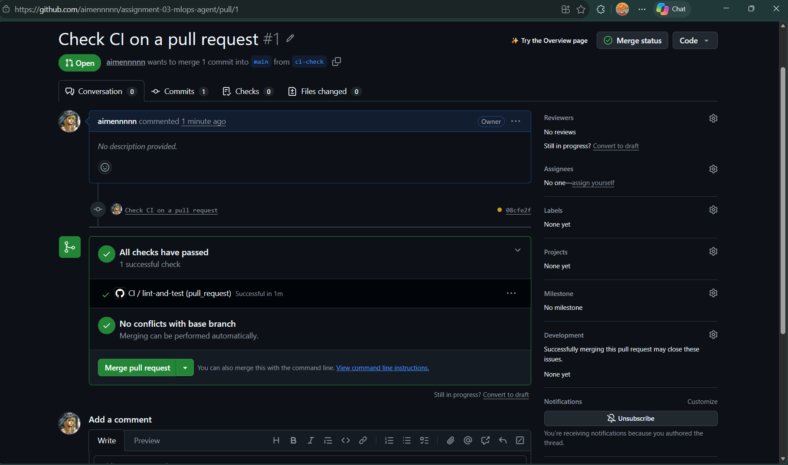

## 8. Fixed after real testing

| Problem I saw | Fix |
|---|---|
| The agent judged retraining without checking Airflow | Code rejects an answer that skipped a system |
| Every run replaced the champion | A model is promoted only if it is better |
| It mixed up the deployed version with the champion | The registry tool names the champion clearly |
| A restart reported 0 ready pods, because it answered too early | The restart tool waits for the rollout |
| A pipeline step took 6 minutes, because calls to MLflow hung | MLflow runs with one worker and a 20 s timeout |

## 9. What I would improve

The biggest gap is that deploying a new champion is still manual. That is why Kubernetes
serves version 4 while the champion is version 5.

| Limit today | What I would do |
|---|---|
| Deploying a new champion is manual | Add a confirmed "deploy champion" tool |
| The DVC remote is a folder in the repo | Move it to cloud storage |
| MLflow uses SQLite and one worker | Move it to PostgreSQL |
| Airflow keeps its history inside the container | Give it its own database |
| The agent's API has no login | Add API keys in front of it |
| The agent forgets between questions | Add short memory per session |
| The LLM calls one tool at a time, so six tools take about a minute | Use an LLM that can call several tools at once |
| The agent only checks when asked | Add scheduled health checks that raise alerts |
| The quality gate checks one score on one split | Add cross-validation and a fixed test set |
