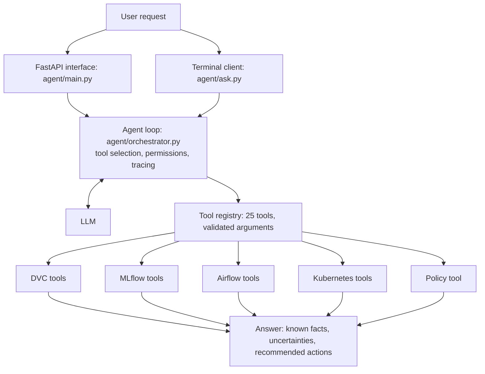

# Technical Report: MLOps AI Agent

**Course:** MLOps & Production AI Engineering, Fall 2026 (Assignment 3)
**Name:** Aimen Ahmad &nbsp;|&nbsp; **Roll number:** 22I-0922 &nbsp;|&nbsp; **Section:** A
**Repository:** https://github.com/aimennnnn/assignment-03-mlops-agent

All figures, ids and outputs in this report come from the running system. Screenshots are
in [`screenshots/`](screenshots) and raw tool output is in [`evidence/`](evidence).

## 1. What was built

An AI agent that answers plain-English questions about one ML project by calling tools
against four real systems, and that can perform two controlled actions after the user
confirms them.

| System | Role in the project | Status at the time of writing |
|---|---|---|
| DVC | Versions the dataset `data/cancer.csv` | 2 versions: `v1.0` (400 rows) and `v2.0` (569 rows) |
| MLflow | Tracks training runs and the Model Registry | 10 runs in 2 experiments, 5 model versions, champion = version 5 |
| Airflow | Runs the 5-stage training pipeline | DAG `training_pipeline`, with successful and failed runs |
| Kubernetes | Serves the prediction API | Deployment `cancer-api`, 2/2 pods ready, ClusterIP Service |

The model is a breast-cancer classifier (scikit-learn). The LLM is `openai/gpt-oss-120b`
on Groq, reached through the standard chat-completions API.

## 2. System architecture



**Request flow.** The LLM receives the user's message and the tool list, and replies with
the tools it wants. For each one, `execute_tool()` validates the arguments, checks the
permission, runs the tool with a timeout and writes a log line. Results go back to the LLM
until it answers. The code then appends what the LLM is not trusted to add itself: failed
tools, a note when no tool was used, and any action waiting for confirmation.

**Split of responsibility.** The LLM decides which tools to use and writes the explanation.
Whether a tool may run is decided by ordinary code.

**Where each system runs.**

| System | Runs in | Reached through |
|---|---|---|
| DVC | Project folder; remote in `dvc-storage/` | `dvc` / `git` via `subprocess`, approved commands only |
| MLflow | Host, port 5000, SQLite backend | `MlflowClient` |
| Airflow 3.4.0 | One Docker container, port 8080 | REST API `/api/v2` with a token from `/auth/token` |
| Kubernetes 1.34 | Docker Desktop cluster, namespace `mlops` | Official Kubernetes Python client |

**Provenance chain.** The same ids appear in every system, which is what makes
correlation possible:

```
DVC         data/cancer.csv -> md5 24d9881f... -> Git tag v2.0 (commit c986c4e)
MLflow      every run is tagged dataset_version=v2.0, dataset_git_commit=c986c4e
Registry    model version -> source run id -> alias "champion"
Kubernetes  image holds model_info.json (model version, run id, dataset version),
            reported live by the app at /version
```

More detail is in [architecture.md](architecture.md).

## 3. Tool definitions and permissions

Every tool returns a dictionary with `"ok": true/false` and never raises. Arguments are
defined as schemas in `agent/schemas.py` and validated before a tool runs.

| Module | Tools | Permission |
|---|---|---|
| DVC (5) | `dvc_list_tracked_datasets`, `dvc_get_current_dataset_version`, `dvc_compare_dataset_versions`, `dvc_check_data_changed`, `dvc_explain_reproduce_version` | Read-only. Only commands in the `ALLOWED` list can run. |
| MLflow (6) | `mlflow_list_experiments`, `mlflow_list_runs`, `mlflow_get_run_details`, `mlflow_find_best_run`, `mlflow_compare_experiments`, `mlflow_get_registered_models` | Read-only |
| Airflow (6) | `airflow_list_dags`, `airflow_get_dag_runs`, `airflow_get_dag_run_status`, `airflow_get_failed_tasks`, `airflow_get_task_diagnostics` | Read-only |
| | `airflow_trigger_training_dag` | **Needs user confirmation.** Only DAGs in `APPROVED_DAGS`. |
| Kubernetes (7) | `k8s_list_workloads`, `k8s_get_pod_status`, `k8s_get_pod_logs`, `k8s_get_services`, `k8s_find_unhealthy_pods`, `k8s_get_deployed_version` | Read-only. Namespace `mlops` only. |
| | `k8s_restart_deployment` | **Needs user confirmation.** Namespace `mlops` only. |
| Policy (1) | `policy_get_retraining_policy` | Read-only |

**Safety controls enforced in code**

| Control | Location |
|---|---|
| State-changing tools never run without confirmation of that exact action | `execute_tool()` in `agent/orchestrator.py` |
| One confirmation allows exactly one change | `run_agent()` |
| Unknown or out-of-range arguments are rejected before the tool runs | `agent/schemas.py` |
| Failed tools are always listed in the answer | `_response()` |
| A retraining assessment must consult MLflow, the registry, DVC, Airflow and Kubernetes | `_missing_evidence()` |
| Bad data or a weak model can never be promoted | `validate()` and `gate()` in `training/pipeline.py` |
| Logs carry a request id and redact secrets | `agent/tracing.py` |

`GET /tools` returns this list from the running code
([screenshot of the API](screenshots/11-agent-api-docs.png)).

## 4. Evidence from the four systems

### 4.1 DVC

Output of the DVC tools ([`evidence/dvc_tools.txt`](evidence/dvc_tools.txt)):

| | v1.0 | v2.0 (current) |
|---|---|---|
| Git commit | `64e5e07` | `c986c4e` |
| md5 of `data/cancer.csv` | `94bc26a8969cf9601bb9e0611024281c` | `24d9881fad8cfb3d94f5276d372e422b` |
| Size | 85,911 bytes | 121,955 bytes |
| Rows | 400 | 569 |

`dvc_check_data_changed` reports `"changed": false`. Reproducible checkout was
demonstrated in both directions:

```
git checkout v1.0 ; dvc checkout   ->  400 rows
git checkout main ; dvc checkout   ->  569 rows
```

A version that does not exist is refused, not guessed:
`"error": "Version 'v9.9' does not exist in this repository"`.

### 4.2 MLflow


Two experiments, `cancer-logreg` (6 runs) and `cancer-rf` (4 runs). The first five runs
were made by hand on both dataset versions:

| Model | Settings | Dataset | F1 |
|---|---|---|---|
| Random forest | 10 trees, depth 2 | v1.0 | 0.9369 |
| Logistic regression | C = 0.01 | v1.0 | 0.9661 |
| Random forest | 10 trees, depth 2 | v2.0 | 0.9457 |
| Random forest | 200 trees, depth 8 | v2.0 | 0.9670 |
| Logistic regression | C = 1.0 | v2.0 | **0.9889** |

The Model Registry holds 5 versions of `cancer-classifier`. Version 5 has the `champion`
alias (run `a8ec401b...`, F1 0.9889, created 2026-11-13 21:50 UTC).

`mlflow_find_best_run` returns cautions with its ranking so the best score is not treated
as production-ready, for example: *"Runs used different dataset versions ['v1.0', 'v2.0'],
so scores are not measured on the same test data."*
Full output: [`evidence/mlflow_tools.txt`](evidence/mlflow_tools.txt).

### 4.3 Airflow

The DAG `training_pipeline` has five tasks in a chain:

```
validate_dataset -> preprocess_data -> train_model -> evaluate_and_log_to_mlflow -> apply_quality_gate
```

Retries: 2 with a 20-second delay, except validation and the quality gate (no retries,
because bad data or a weak model does not fix itself). A failed task stops every task
after it.


The two failed runs are the deliberately injected failures (section 6 and the weak-model
run). Recent runs as returned by `airflow_get_dag_runs`
([`evidence/airflow_tools.txt`](evidence/airflow_tools.txt)):

| Run (UTC) | State | Duration | Failed task |
|---|---|---|---|
| 2026-11-13 22:11:36 | success | 30.1 s | |
| 2026-11-13 22:11:05 | failed | 10.9 s | `validate_dataset` |
| 2026-11-13 21:49:23 | success | 48.2 s | |
| 2026-11-13 19:56:30 | failed | 31.2 s | `apply_quality_gate` (weak random forest) |

### 4.4 Kubernetes


```
NAME                              READY   STATUS    RESTARTS      AGE
pod/cancer-api-68876699c6-5zh6c   1/1     Running   1 (27m ago)   12h
pod/cancer-api-68876699c6-xrx6r   1/1     Running   1 (27m ago)   12h

service/cancer-api   ClusterIP   10.96.123.234   <none>   80/TCP   13h
deployment.apps/cancer-api   2/2   2   2   13h
```

(The single restart is from the laptop being switched off overnight.)

| Requirement | Implementation |
|---|---|
| At least 2 replicas | `replicas: 2` |
| ClusterIP Service | `kubernetes/service.yaml`, port 80 to 8000 |
| Readiness and liveness probes | `GET /ready` and `GET /health` |
| CPU and memory requests and limits | 100m / 256Mi requested, 500m / 512Mi limit |
| ConfigMap for non-sensitive settings | `cancer-api-config` (`APP_VERSION`, `MODEL_PATH`, `LOG_LEVEL`) |

`k8s_get_deployed_version` asks the running app which model it serves: app 1.0.0, model
`cancer-classifier` version 4, run `596f7cab...`, F1 0.9889, dataset `v2.0`
([`evidence/kubernetes_tools.txt`](evidence/kubernetes_tools.txt)).

## 5. Tested agent conversations

Each conversation lists the tools the agent chose and what they returned. Durations are
from the agent's own log.

### Conversation 1: the mandatory multi-tool scenario

> Find the best recent model, identify the dataset version used to train it, check the
> deployment status, and explain whether retraining is necessary.


| Tool | Status | Time |
|---|---|---|
| `policy_get_retraining_policy` | ok | 11 ms |
| `mlflow_find_best_run` | ok | 773 ms |
| `mlflow_get_registered_models` | ok | 199 ms |
| `k8s_get_deployed_version` | ok | 1263 ms |
| `dvc_get_current_dataset_version` | ok | 4146 ms |
| `airflow_get_dag_runs` | ok | 948 ms |

**Answer (summarised).** Best recent run has F1 0.9889 on dataset v2.0. The registry
champion is version 5. The deployed API reports version 4. The current DVC version is v2.0
(commit `c986c4e`). The latest pipeline run succeeded. None of the policy's evidence
conditions is met, so **no retraining**; but the deployment is one version behind the
champion, so **redeploy**. The agent kept those two apart.

### Conversation 2: the same question when the evidence was different

Asked earlier, when the most recent pipeline run was the one that failed its quality gate.

| Tool | Status | Time |
|---|---|---|
| `mlflow_find_best_run` | ok | 202 ms |
| `k8s_get_deployed_version` | ok | 879 ms |
| `policy_get_retraining_policy` | ok | 2 ms |
| `dvc_get_current_dataset_version` | ok | 2613 ms |
| `airflow_get_dag_runs` | ok | 951 ms |

**Answer (quoted).** *"Retraining is recommended because the latest pipeline run failed
its quality gate and no subsequent run passed, satisfying the policy's evidence
condition."* It did not start a run; it offered to trigger one if confirmed.

Conversations 1 and 2 give opposite recommendations for the same question, each matching
the state of the system at the time.

### Conversation 3: a state-changing request

> Trigger the model training pipeline and report whether execution succeeded.

First reply: `airflow_trigger_training_dag` had status `needs_confirmation` (0 ms, not
executed) and the agent waited. After the user typed `yes`:

| Tool | Status | Time |
|---|---|---|
| `airflow_trigger_training_dag` | ok | 744 ms |
| `airflow_get_dag_run_status` | ok | 48,683 ms (waited for the run) |

**Answer (summarised).** Run `manual__2026-11-13T21:49:23` finished with state `success`
in about 48 seconds, and all five tasks succeeded.

### Conversation 4: diagnosing a failed pipeline run

> The latest training pipeline run failed. Find out which task failed and why, and tell me
> how to fix it.

| Tool | Status | Time |
|---|---|---|
| `airflow_get_dag_runs` | ok | 115 ms |
| `airflow_get_failed_tasks` | ok | 47 ms |
| `airflow_get_task_diagnostics` | ok | 181 ms |

**Answer (quoted).** *"Failed task: `validate_dataset` ... `data/cancer.csv was changed
without 'dvc add': its hash 99e2a9a36188b95b9342145e3c6025bc is not the DVC version
24d9881fad8cfb3d94f5276d372e422b`"*. See section 6.1.

### Conversation 5: diagnosing an unavailable API

> Why is my prediction API unavailable?

| Tool | Status | Time |
|---|---|---|
| `k8s_list_workloads` | ok | 1199 ms |
| `k8s_get_pod_logs` | ok | 46 ms |
| `k8s_get_deployed_version` | ok | 12 ms |

**Answer (summarised).** 0 of 2 replicas ready, both pods in `CrashLoopBackOff`; the log
shows the model file `/app/model/missing-model.joblib` does not exist; the ConfigMap's
`MODEL_PATH` points to that file. See section 6.2.

### Conversation 6: a service is unavailable

> What is the best model by F1 score?

Asked while the agent was pointed at an address with no MLflow server.

| Tool | Status | Time |
|---|---|---|
| `mlflow_find_best_run` | error | 2057 ms |
| `mlflow_list_runs` | error | 2028 ms |
| `mlflow_get_registered_models` | error | 2082 ms |

**Answer (quoted).** *"No run metrics, model versions, or registry entries are available,
so the best-by-F1 model cannot be identified."* The reply ended with the code-generated
note **"Unavailable evidence"** listing all three failed tools. No metric was invented.

## 6. Failure investigations

### 6.1 Data changed without DVC (data and workflow layers)

| | |
|---|---|
| **Injected fault** | One line appended to `data/cancer.csv` without running `dvc add` |
| **Symptom** | Pipeline run `manual__2026-11-13T22:11:05` failed after 10.9 s |
| **How the agent diagnosed it** | `airflow_get_dag_runs` found the failed run, `airflow_get_failed_tasks` named `validate_dataset` and showed the four later tasks were not run, `airflow_get_task_diagnostics` read the task log |
| **Evidence** | Log line: the file's hash `99e2a9a3...` is not the DVC version `24d9881f...` |
| **Root cause** | The working copy of the dataset no longer matched the version recorded in DVC, so the training data had no known provenance |
| **Why nothing bad happened** | Validation is the first task and has no retries. Its failure set every later task to `upstream_failed`, so no model was trained or promoted |
| **Resolution** | `dvc checkout --force` restored the tracked file. The next run (`22:11:36`) succeeded in 30.1 s |
| **Note** | The agent suggested `dvc add`, which is correct when the change is intended. Here it was not, so restoring was the right fix. Both are valid depending on intent |

### 6.2 Wrong configuration on Kubernetes (infrastructure layer)

| | |
|---|---|
| **Injected fault** | ConfigMap applied with `MODEL_PATH=/app/model/missing-model.joblib`, pods deleted so new ones start with it |
| **Symptom** | Prediction API unavailable |
| **How the agent diagnosed it** | `k8s_list_workloads` showed 0 ready replicas and `CrashLoopBackOff`, `k8s_get_pod_logs` gave the startup error, `k8s_get_deployed_version` showed the ConfigMap value |
| **Evidence** | Exit code 3, restart count rising, `BackOff` events (count 9), Service with 0 ready endpoints (`can_serve_traffic: false`), log `FileNotFoundError: ... '/app/model/missing-model.joblib'` |
| **Root cause** | A configuration error, not a code or image problem: the app was told to load a model file that is not in the image, so it exited on startup every time |
| **Resolution** | `kubectl apply -f kubernetes/configmap.yaml`, then the agent's `k8s_restart_deployment` after user confirmation. Both pods returned to `1/1 Running` with 0 restarts |
| **Improvement made** | Immediately after the restart the agent truthfully reported 0 ready replicas, because the new pods were still starting. The restart tool now waits for the rollout and reports whether it finished |

## 7. Testing and CI

- **52 automated tests** in 8 files; all pass locally and on GitHub
  ([`evidence/tests.txt`](evidence/tests.txt)).
- They need no MLflow, Airflow, Kubernetes, network or API key: a fake cluster
  (`tests/fake_k8s.py`), a scripted model (`tests/fake_llm.py`), and mocked HTTP and
  command-line calls.

| Requirement | Test |
|---|---|
| Successful tool selection and execution | `test_agent_runs_the_tools_the_model_selects` |
| Tool timeouts | `test_tool_timeout_is_handled`, `test_airflow_timeout`, `test_dvc_timeout_is_reported` |
| Invalid requests | `test_invalid_arguments_are_rejected_before_the_tool_runs`, `test_invalid_requests_are_rejected` |
| Service failures | `test_mlflow_down_returns_an_error_not_data`, `test_airflow_down_returns_an_error_not_data`, `test_no_cluster_configured` |
| No invented results | `test_agent_does_not_invent_results_when_a_tool_is_unavailable` |
| Unauthorized Kubernetes changes rejected | `test_unauthorized_kubernetes_modification_is_rejected` |
| Logs without secrets | `test_every_tool_call_is_logged_without_secrets`, `test_secret_values_are_redacted` |
| Quality gate blocks promotion | `test_gate_blocks_a_model_below_the_threshold`, `test_gate_blocks_a_model_worse_than_the_champion` |

**CI.** `.github/workflows/ci.yml` runs `ruff check .` and `pytest` on every pull request
and every push to `main`.


**Structured logs.** One JSON line per event in `logs/agent.jsonl`
([`evidence/agent_logs.txt`](evidence/agent_logs.txt)):

```json
{"time": "2026-11-14T10:13:29.321+00:00", "event": "tool_call", "request_id": "3b9053bbf846",
 "tool": "dvc_get_current_dataset_version", "arguments": {}, "status": "ok", "ok": true,
 "duration_ms": 4146, "error": null}
```

## 8. Problems found during testing and how they were fixed

Running the agent against the real systems exposed issues that unit tests alone would not
have.

| Problem observed | Fix |
|---|---|
| A pipeline stage took 6 minutes because requests to MLflow hung for 120 s and then succeeded on retry | MLflow started with one worker; request timeout in the Airflow container reduced to 20 s |
| The agent judged retraining without calling any Airflow tool, yet wrote that there was no quality-gate failure | Code check: a retraining assessment is rejected once if any of the systems was not consulted |
| Before a confirmation, the LLM described pipeline steps that do not exist (for example deploying to Kubernetes) | When only a confirmation is pending, the message is written by code from the tool's own description |
| The agent confused the deployed model version with the registry champion | The registry tool returns the champion explicitly; the agent must compare it with the deployed version |
| Every successful pipeline run replaced the champion with an identical model | A model is promoted only if it is better than the champion |
| A pod that had restarted once but was ready was counted as unhealthy | Only pods that are not ready count as unhealthy; past restarts are listed separately |

## 9. Known limitations and proposed improvements

| Limitation | Proposed improvement |
|---|---|
| The DVC remote is a folder inside the repository | Use cloud storage (S3, GCS or Azure) with restricted credentials |
| MLflow uses SQLite and a single worker | PostgreSQL backend and object storage for artifacts |
| Airflow runs in `standalone` mode with its history inside the container | Separate metadata database, a production executor and a persistent volume |
| Deploying a new champion is manual (export, build, apply); the deployment currently serves version 4 while the champion is version 5 | A confirmed "deploy champion" tool, or a deployment stage in the DAG after the quality gate |
| The LLM calls tools one at a time, so a six-tool answer needs seven LLM calls and can take about a minute on the free rate limit | A model or provider with parallel tool calls and higher limits; cache the tool list |
| The agent is stateless between questions | Short conversation memory keyed by a session id |
| The quality gate checks one metric on one test split | Cross-validation, a fixed hold-out set, and drift and latency checks |
| The agent reads logs and events only when asked | Scheduled health checks that raise alerts on failed runs or unhealthy pods |
| No authentication on the agent's own API | API keys or OAuth in front of `POST /chat`, and per-user permissions for state-changing tools |
