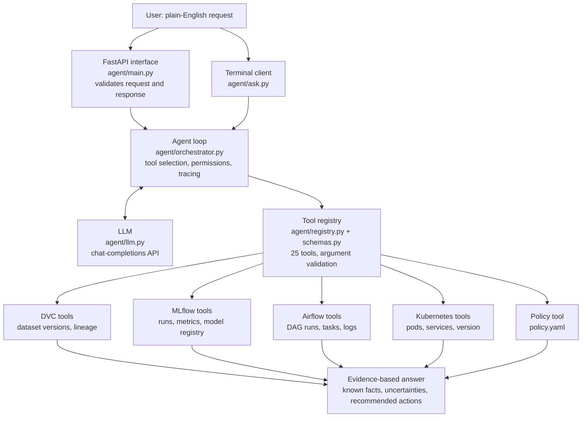

# Architecture

## Overview



## How one request is handled

1. The user sends a message through `POST /chat` or `python -m agent.ask`.
2. `run_agent()` gives the LLM the message, a short system prompt and the list of tools
   (name, one-line description, JSON schema of the arguments).
3. The LLM replies with the tools it wants to call. It never talks to a system itself.
4. For each requested tool, `execute_tool()`:
   - checks the tool exists,
   - validates the arguments against the tool's schema,
   - refuses a state-changing tool unless the user confirmed that exact action,
   - runs the tool with a timeout,
   - writes one structured log line (request id, tool, status, duration).
5. The tool result goes back to the LLM. Steps 3 to 5 repeat until the LLM answers.
6. Before returning, the code adds what the LLM is not trusted to add by itself:
   the list of failed tools, a note if no tool was called, and the pending action.

The LLM decides *which* tools to use and writes the explanation. Everything about
*whether* a tool may run is decided by ordinary code.

## The four systems

| System | What runs where | How the tools reach it |
|---|---|---|
| DVC | The project folder (Git + DVC), remote in `dvc-storage/` | `dvc` and `git` commands through `subprocess`, restricted to an approved list |
| MLflow | Tracking server on the host, port 5000, SQLite backend | `MlflowClient` (Python API) |
| Airflow | One Docker container (`docker-compose.yml`), port 8080 | Airflow 3 REST API (`/api/v2`) with a login token from `/auth/token` |
| Kubernetes | Docker Desktop cluster, namespace `mlops` | Official Kubernetes Python client, using the local kubeconfig |

## Provenance chain

The same identifiers appear in every system, which is what lets the agent correlate them:

```
DVC          data/cancer.csv  ->  md5 hash  ->  Git tag v2.0 (commit c986c4e)
MLflow       each run is tagged dataset_version, dataset_git_commit, dataset_md5
Registry     model version  ->  source run id  ->  alias "champion"
Kubernetes   image contains model_info.json: model version, run id, dataset version
             (the running app reports it at /version)
Airflow      each pipeline run tags its MLflow run with the Airflow run id
```

So "which dataset trained the model that is deployed?" is answered by following ids,
not by guessing.

## Training pipeline (Airflow DAG)

```
validate_dataset -> preprocess_data -> train_model -> evaluate_and_log_to_mlflow -> apply_quality_gate
```

- **validate**: file exists, hash equals the DVC pointer, at least 100 rows, no missing
  values, both classes present. No retries (bad data does not fix itself).
- **preprocess / train / evaluate**: retried up to 2 times, 20 seconds apart.
- **quality gate**: fails if F1 is below `min_f1` or below the current champion.
  A model is registered and given the `champion` alias only if it is better than the
  current champion. No retries.
- A failed task stops every task after it, so bad data or a weak model is never promoted.
- The DAG tasks run the training code in a separate Python environment inside the
  Airflow image, so training libraries cannot clash with Airflow's own.

## Tools and permissions

Read-only tools run freely. The two state-changing tools need the user's confirmation.

| Tool | Permission |
|---|---|
| `dvc_list_tracked_datasets`, `dvc_get_current_dataset_version`, `dvc_compare_dataset_versions`, `dvc_check_data_changed`, `dvc_explain_reproduce_version` | read-only |
| `mlflow_list_experiments`, `mlflow_list_runs`, `mlflow_get_run_details`, `mlflow_find_best_run`, `mlflow_compare_experiments`, `mlflow_get_registered_models` | read-only |
| `airflow_list_dags`, `airflow_get_dag_runs`, `airflow_get_dag_run_status`, `airflow_get_failed_tasks`, `airflow_get_task_diagnostics` | read-only |
| `airflow_trigger_training_dag` | **needs confirmation**; approved DAGs only |
| `k8s_list_workloads`, `k8s_get_pod_status`, `k8s_get_pod_logs`, `k8s_get_services`, `k8s_find_unhealthy_pods`, `k8s_get_deployed_version` | read-only; namespace `mlops` only |
| `k8s_restart_deployment` | **needs confirmation**; namespace `mlops` only |
| `policy_get_retraining_policy` | read-only |

`GET /tools` returns this list from the running code.

## Retraining decisions

`policy.yaml` states the only accepted reasons to recommend retraining:

1. the champion model is older than `max_model_age_days`,
2. the champion was trained on an older dataset version than the current one,
3. the most recent pipeline run failed its quality gate and no later run passed,
4. the user supplied results showing the deployed model has degraded.

When the agent reads this policy, the code requires evidence from MLflow, the Model
Registry, DVC, Airflow and Kubernetes before it accepts the answer. Retraining is never
started by such a question: triggering needs an explicit request and a confirmation.

## Design choices

| Choice | Reason |
|---|---|
| Tool calling written directly against the chat-completions API, no agent framework | The whole loop is about 150 lines, easy to read, test and defend. Any provider works by changing three settings. |
| One schema per tool (`pydantic`) | Arguments from the LLM are untrusted input; they are validated like any API request. |
| Confirmation enforced in code, with the exact pending action returned to the user | A prompt instruction can be ignored by a model; a code check cannot. |
| Every tool returns `{"ok": true/false, ...}` and never raises | A failing service becomes data the agent can report, not a crash. |
| Tool results are shortened before they reach the LLM | Keeps requests small and within free rate limits. |
| Training libraries in their own environment inside the Airflow image | Avoids dependency conflicts with Airflow. |
| Model baked into the API image with `model_info.json` | The deployed version is exact and traceable; pods do not depend on MLflow being up. |
| Tests use fakes shaped like real API replies | The suite runs anywhere in seconds, including GitHub Actions. |

## Logging

Each request gets a `request_id`. `logs/agent.jsonl` receives one JSON line per event:

```json
{"time": "...", "event": "tool_call", "request_id": "25beb39fd412",
 "tool": "mlflow_find_best_run", "arguments": {"metric": "f1"},
 "status": "error", "ok": false, "duration_ms": 2057,
 "error": "MLflow tracking server at ... is not reachable or failed"}
```

Keys that look like secrets (`password`, `token`, `api_key`, ...) are replaced by `***`.
The LLM API key is only ever sent in the request header and is never logged.
